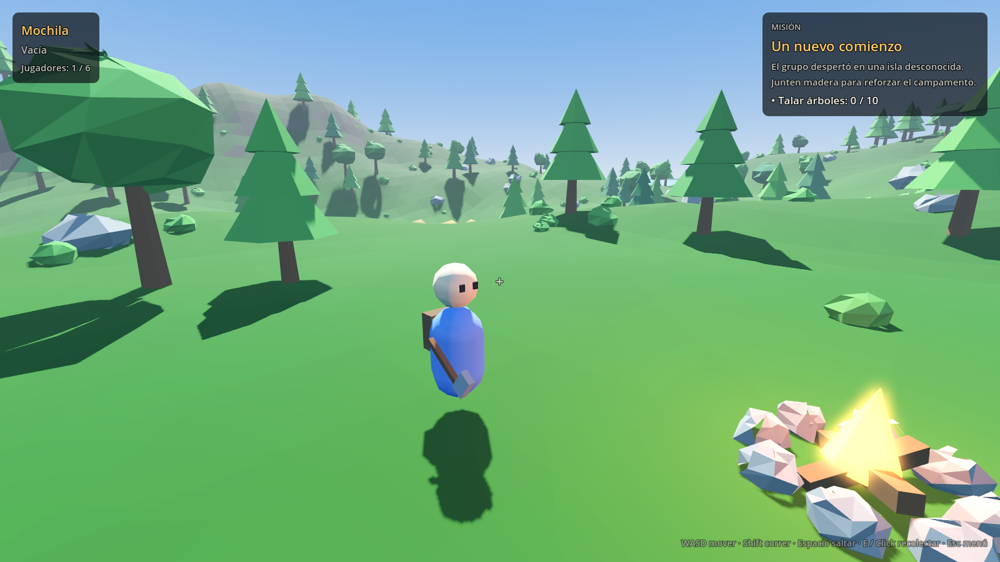

# Tierras Compartidas

RPG cooperativo de mundo abierto en 3D (2 a 6 jugadores) hecho con **Godot 4.3+** y **GDScript**.
Estilo low-poly: liviano para cualquier PC, pero con iluminación, sombras, niebla y brillo.



## Cómo abrirlo

1. Descargá Godot 4.3 o superior (versión estándar, **no** la .NET): https://godotengine.org/download
2. Abrí Godot → **Importar** → elegí el archivo `project.godot` de esta carpeta.
3. Apretá **F5** para jugar → **Crear partida**.

## Probar el cooperativo en una sola PC

En el editor: **Depurar → Personalizar instancias de ejecución…** → activá *Habilitar múltiples instancias* y poné 2 o 3.
Al apretar F5 se abren varias ventanas: en una tocá **Crear partida**, en las otras **Unirse** (IP `127.0.0.1`).

También por línea de comandos:

```bash
godot --path . -- --host --name=Ana
godot --path . -- --join=127.0.0.1 --name=Beto
```

## Jugar con amigos

- **Misma red (LAN):** el host comparte su IP local (ej. `192.168.0.10`) y los demás se unen con esa IP.
- **Por internet:** la forma más fácil es una VPN de juego como **Tailscale**, **ZeroTier** o **Radmin VPN** (todos instalan la misma y usan la IP que les da).
  Alternativa: abrir el puerto **UDP 7777** en el router del host.
- Más adelante se puede integrar **Steam** (GodotSteam) para invitar amigos sin IPs.

## Controles

| Tecla | Acción |
|---|---|
| WASD / flechas | Moverse |
| Mouse | Cámara |
| Shift | Correr |
| Espacio | Saltar |
| E / Click izquierdo (mantener) | Talar árboles / picar rocas |
| Esc | Menú de pausa · saltear cinemática |

## Qué incluye este prototipo

- **Isla procedural** de 256 × 256 m generada con una semilla compartida: todos los jugadores ven el mismo mundo sin enviar el terreno por red.
- **Recursos:** árboles (madera) y rocas (piedra), que reaparecen a los 90 segundos.
- **Multiplayer cooperativo** de 2 a 6 jugadores con ENet. El host es la autoridad: valida la distancia y el ritmo de recolección y lleva los inventarios.
- **Misiones compartidas:** el progreso es del grupo entero. Hay 3 misiones de ejemplo: recolectar, recolectar y llegar a un lugar.
- **Cinemáticas:** planos de cámara con barras negras, subtítulos y fundidos. Hay una intro, la revelación del monolito y el final de la demo.
- **HUD:** mochila, misión actual, jugadores conectados, avisos y menú de pausa.
- **Gente que entra tarde:** recibe las misiones y los recursos agotados al conectarse.

## Estructura

```
scenes/
  main.tscn            Escena principal (mundo + spawner de jugadores)
  player.tscn          Jugador + MultiplayerSynchronizer
scripts/
  main.gd              Menú → mundo, argumentos de línea de comandos
  autoload/
    game.gd            Estado local: inventario, ítems, controles, pausa
    network.gd         Host / unirse, registro de jugadores (ENet)
    quest_manager.gd   Misiones cooperativas (datos + lógica del servidor)
    cinematics.gd      Reproductor de cinemáticas
  world/
    world.gd           Genera el mundo + lógica del servidor (recolección, inventarios)
    terrain_generator.gd  Terreno low-poly procedural
    prop_factory.gd    Modelos low-poly por código (árboles, rocas, monolito, fogata)
    resource_node.gd   Recurso recolectable
  player/player.gd     Movimiento, cámara 3ª persona, interacción
  ui/                  Menú principal, HUD y estilos
```

### Cómo agregar cosas

- **Una misión nueva:** agregá un diccionario a `QUESTS` en `quest_manager.gd`.
- **Una cinemática:** agregá un caso en `build_cinematic()` de `world.gd`. Cada plano tiene posición inicial y final de la cámara, el punto al que mira, la duración y el texto.
- **Un ítem:** agregalo en `ITEMS` de `game.gd`.

## Hoja de ruta

1. ~~Prototipo base: mundo, jugador, cooperativo~~ ✅
2. ~~Recolección de madera y piedra~~ ✅
3. ~~Misiones y cinemáticas básicas~~ ✅
4. **Crafteo:** mesa de trabajo y recetas (hacha de piedra, antorcha…)
5. **Construcción:** piezas con encaje (piso, pared, techo) de madera y piedra
6. **NPCs con diálogos** y cadenas de misiones
7. Ciclo día/noche, clima y biomas
8. Enemigos y combate cooperativo
9. Guardado de partida (mundo, construcciones, inventarios)
10. Personajes animados (Mixamo o Blender) y sonido
11. Mundo más grande por zonas, menú de opciones gráficas
