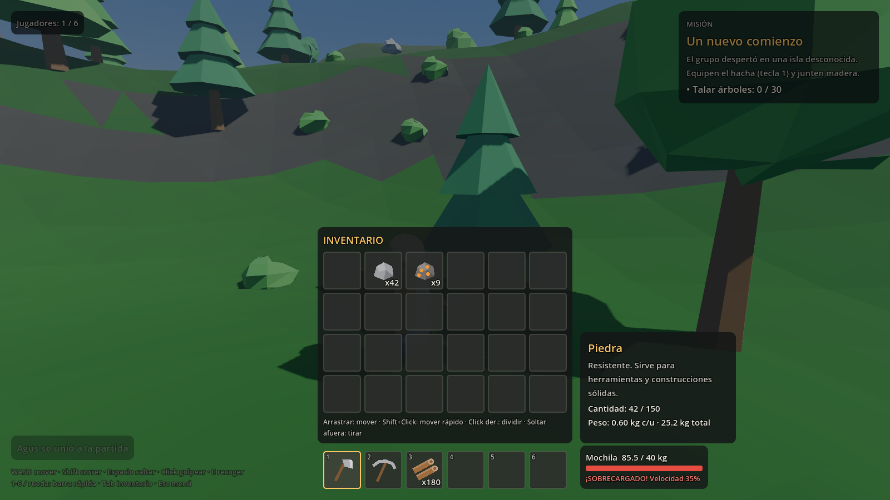

# NEXORA

RPG cooperativo de mundo abierto en 3D (2 a 6 jugadores) hecho con **Godot 4.3+** y **GDScript**.
Estilo low-poly: liviano para cualquier PC, pero con iluminación, sombras, niebla y brillo.



## Cómo abrirlo

1. Descargá Godot 4.3 o superior (versión estándar, **no** la .NET): https://godotengine.org/download
2. Abrí Godot → **Importar** → elegí el archivo `project.godot` de esta carpeta.
3. Apretá **F5** para jugar → **Crear partida**.

## Opciones (menú principal o Esc → Opciones)

- **Pantalla:** modo (ventana, maximizada o pantalla completa), resolución, tamaño de la interfaz, VSync y contador de FPS.
- **Cámara:** distancia, altura, hombro (izquierda/centro/derecha), campo de visión, sensibilidad del mouse e invertir eje Y.
- **Gráficos:** calidad baja, media o alta. Baja es ideal para notebooks.

Las opciones se guardan solas y se mantienen la próxima vez que abras el juego.
Por defecto el juego arranca en **ventana maximizada**, así entra en cualquier pantalla.

## Probar el cooperativo en una sola PC

En el editor: **Depurar → Personalizar instancias de ejecución…** → activá *Habilitar múltiples instancias* y poné 2 o 3.
Al apretar F5 se abren varias ventanas: en una tocá **Crear partida**, en las otras **Unirse** (IP `127.0.0.1`).

También por línea de comandos:

```bash
godot --path . -- --host --name=Ana
godot --path . -- --join=127.0.0.1 --name=Beto
```

## Jugar con amigos

- **Misma red (LAN):** el host comparte su IP local (ej. `192.168.0.10`) y los demás se unen con esa IP.
- **Por internet:** la forma más fácil es una VPN de juego como **Tailscale**, **ZeroTier** o **Radmin VPN** (todos instalan la misma y usan la IP que les da).
  Alternativa: abrir el puerto **UDP 7777** en el router del host.
- Más adelante se puede integrar **Steam** (GodotSteam) para invitar amigos sin IPs.

## Controles

| Tecla | Acción |
|---|---|
| WASD / flechas | Moverse |
| Mouse | Cámara |
| Shift | Correr |
| Espacio | Saltar |
| Click izquierdo (mantener) | Talar árboles / picar rocas |
| E | Recoger bolsas del suelo |
| 1-6 / rueda del mouse | Elegir objeto de la barra rápida |
| Tab / I | Abrir inventario |
| V | Cámara cerca / normal / lejos |
| Esc | Cerrar inventario · menú de pausa · saltear cinemática |

### Inventario

| Acción | Resultado |
|---|---|
| Arrastrar a otro casillero | Mover, juntar pilas o intercambiar |
| Shift + Click | Mover rápido entre barra rápida y mochila |
| Click derecho | Dividir la pila a la mitad |
| Soltar fuera del inventario | Tirar al suelo en una bolsa (cualquier compañero la puede recoger) |

## Qué incluye este prototipo

- **Isla procedural** de 256 × 256 m generada con una semilla compartida: todos los jugadores ven el mismo mundo sin enviar el terreno por red.
- **Recursos:** árboles (madera), rocas (piedra) y rocas con vetas naranjas (mineral de metal). Reaparecen a los 90 segundos.
- **Inventario por casilleros:** 6 de barra rápida + 24 de mochila, con pilas, arrastrar y soltar, dividir y tirar al suelo.
- **Peso:** cada objeto pesa. Hasta el 40% de la capacidad (40 kg) te movés normal. Después vas cada vez más lento, y si te pasás de la capacidad quedás sobrecargado: sin correr y con saltos cortos. La mochila del personaje crece a la vista.
- **Herramientas:** con el hacha o el pico en la mano sacás el triple de recursos. Arrancás con las dos.
- **Bolsas en el suelo:** si se te llena el inventario, lo que no entra cae al piso. Cualquiera puede recogerlo y desaparece a los 5 minutos.
- **Volver a entrar:** si salís y volvés a la misma partida con el mismo nombre, recuperás tu inventario.
- **Multiplayer cooperativo** de 2 a 6 jugadores con ENet. El host es la autoridad: valida la distancia y el ritmo de recolección y lleva los inventarios.
- **Misiones compartidas:** el progreso es del grupo entero. Hay 3 misiones de ejemplo: recolectar, recolectar y llegar a un lugar.
- **Cinemáticas:** planos de cámara con barras negras, subtítulos y fundidos. Hay una intro, la revelación del monolito y el final de la demo.
- **HUD:** mochila, misión actual, jugadores conectados, avisos y menú de pausa.
- **Gente que entra tarde:** recibe las misiones y los recursos agotados al conectarse.

## Estructura

```
scenes/
  main.tscn            Escena principal (mundo + spawner de jugadores)
  player.tscn          Jugador + MultiplayerSynchronizer
scripts/
  main.gd              Menú → mundo, argumentos de línea de comandos
  autoload/
    settings.gd        Opciones del jugador (se guardan en user://settings.cfg)
    game.gd            Estado local: inventario, barra rápida, peso, controles, pausa
    network.gd         Host / unirse, registro de jugadores (ENet)
    quest_manager.gd   Misiones cooperativas (datos + lógica del servidor)
    cinematics.gd      Reproductor de cinemáticas
  world/
    world.gd           Genera el mundo + lógica del servidor (recolección, inventarios)
    terrain_generator.gd  Terreno low-poly procedural
    prop_factory.gd    Modelos low-poly por código (árboles, rocas, monolito, fogata)
    resource_node.gd   Recurso recolectable
  data/
    item_db.gd         Todos los ítems (nombre, peso, pila, herramienta)
    inventory.gd       Lógica del inventario (agregar, mover, dividir, peso)
  world/item_drop.gd   Bolsa en el suelo
  player/player.gd     Movimiento, peso, cámara 3ª persona, herramientas, interacción
  ui/
    inventory_ui.gd    Barra rápida, ventana de inventario, indicador de carga
    item_slot.gd       Casillero con arrastrar y soltar
    item_icon.gd       Íconos dibujados por código
    settings_menu.gd   Menú de opciones
```

### Cómo agregar cosas

- **Una misión nueva:** agregá un diccionario a `QUESTS` en `quest_manager.gd`.
- **Una cinemática:** agregá un caso en `build_cinematic()` de `world.gd`. Cada plano tiene posición inicial y final de la cámara, el punto al que mira, la duración y el texto.
- **Un ítem:** agregalo en `ITEMS` de `scripts/data/item_db.gd` (nombre, peso, pila) y su ícono en `item_icon.gd`.
- **Cambiar cuánto se puede cargar:** `CAPACITY_KG` en `scripts/data/inventory.gd`.

## Hoja de ruta

1. ~~Prototipo base: mundo, jugador, cooperativo~~ ✅
2. ~~Recolección de madera y piedra~~ ✅
3. ~~Misiones y cinemáticas básicas~~ ✅
4. ~~Inventario por casilleros, peso y herramientas~~ ✅
5. **Crafteo:** mesa de trabajo y recetas (hacha de piedra, antorcha…)
6. **Construcción:** piezas con encaje (piso, pared, techo) de madera y piedra
7. **NPCs con diálogos** y cadenas de misiones
8. Ciclo día/noche, clima y biomas
9. Enemigos y combate cooperativo
10. Guardado de partida (mundo, construcciones, inventarios)
11. Personajes animados (Mixamo o Blender) y sonido
12. Mundo más grande por zonas, menú de opciones gráficas
